# AI-augmented legal agent

A role a language model fills for a company: keeping its legal constraints. Each constraint is one line, with its
article read at the source. An open point gets a temporary measure that lets the work go on, and one answerable
question for the person who settles it. It is the secretary of the company's jurist, never the jurist: it **never concludes on law**, decides,
signs, pays, sends or publishes.

> **Status (2026-11-12):** seven review passes, no fixed point; the review this family asks before a principle is not
> done. Its remaining serious finding is that an agent can write the evidence it is judged on, which waits on a runner
> that separates write permissions ([passes](agent/passes.md)).
>
> **How it is made:** with Claude, an AI assistant by Anthropic, under the maintainer's direction. Nothing here is legal
> advice. Corrections are welcome as issues.

## A role extends a skill

| | A skill | A role, as the AI-augmented family defines it |
|---|---|---|
| What it is | a set of instructions a model loads | a skill, plus what makes its work checkable |
| Who judges it | nobody named | a program or a person, never itself: its card says which |
| Exactness | the model's | programs with a proof or a test for every task a program can do; the model maps to them and back |
| When it is ready | when written | at its fixed point: two fresh-reader passes in a row with no serious and no medium finding |
| What it may never do | unstated | decide, sign, pay, send, publish, and write the evidence it is judged on |

This agent's skill is [agent/SKILL.md](agent/SKILL.md); the rest of [agent/](agent/README.md) is what makes it a role.

## The loop

```dot
// The legal agent's loop: a plan becomes constraints; an open point gets a temporary measure and a question for the jurist.
digraph legal_agent {
  graph [rankdir=LR, nodesep=0.35, ranksep=0.45, bgcolor="white", pad=0.2, fontname="Inter"];
  node  [shape=box, style="rounded,filled", fontname="Inter", fontsize=12, margin="0.15,0.08", penwidth=1.4, fontcolor="#1F2328", fillcolor="#FFFFFF", color="#3D434B"];
  edge  [fontname="Inter", fontsize=10, color="#3D434B", fontcolor="#55575F", penwidth=1.2, arrowsize=0.8];
  PLAN [label=<<b>plan or act</b>>];
  AGENT [label=<<b>legal agent</b><br/><font point-size="10" color="#55575F">drafts, never decides</font>>, fillcolor="#E8EEF8", color="#2F5DA8"];
  REG [label=<<b>register</b><br/><font point-size="10" color="#55575F">one line per constraint</font>>];
  J [label=<<b>objective J</b><br/><font point-size="10" color="#55575F">maximised under them</font>>, fillcolor="#E6F2EA", color="#2E7D4F"];
  TMP [label=<<b>temporary measure</b><br/><font point-size="10" color="#55575F">risk, date, issue</font>>, style="rounded,filled,dashed"];
  JUR [label=<<b>jurist</b><br/><font point-size="10" color="#55575F">a person, settles</font>>, fillcolor="#FBEDE4", color="#B4541A"];
  PLAN -> AGENT -> REG -> J;
  REG -> TMP [label=" open point, a person approves"];
  AGENT -> JUR [label=" one question per point, sent by a person"];
  JUR -> REG [label=" answer recorded"];
}
```

Graphviz source

- The agent is [agent/](agent/README.md): its skill, four prompts (review a plan, a temporary measure, the dossiers, an
  answer), the register's columns, a rubric and two tested programs.
- Taking over a company's existing register is a one-time job done with a person: [jobs/](jobs/take-over-a-legal-register.md).

## Where it sits

| Repository | What it gives this one |
|---|---|
| [law-oracle](https://github.com/Tewf/law-oracle/tree/26c95ee) | a statute written as code, a verdict with its trace; the agent quotes a verdict as a question, never as a finding |
| [ai-augmented-law-oracle](https://github.com/Tewf/ai-augmented-law-oracle) | a model's encoding of a statute, accepted only at zero disagreement |
| [ai-augmented-data-gathering](https://github.com/Tewf/ai-augmented-data-gathering/blob/f1767a9/skills/gather-data/SKILL.md) | the gather-data skill: when a search for what applies may stop |

It has a repository of its own because the role needs attention of its own ([decision 0001](decisions/0001-a-repository-of-its-own.md)).

## The role card

Every role opens with one table, every cell filled. Its fields:

- Role, and Kind: guard, objective or coordinator;
- Maximises or guards, and Never does: at least decide, sign, pay, send, publish;
- Judged by: a program or a person, never itself; and Base to beat;
- Hands to, Mapping, Programs it uses, Runs on, Fixed point.

This agent's is in [agent/README.md](agent/README.md).

## Reaching a fixed point

- A fresh reader reviews the folder, and one of the passes runs it on a real input. The fixed point is two passes in
  a row with no serious and no medium finding, on the model its card's Runs on names.
- From the first pass the scope is frozen: a fix corrects or narrows what the folder holds, and a new capability waits
  in [queue.md](agent/queue.md).
- No agent writes an input of its own verdict: a program reads the producer's output directly.

## Scope

| | What | Why |
|---|---|---|
| in | the register, its states and the person who approves; the dossiers for the person who settles | the role's one job |
| in | two guards against concluding: a program on listed phrases, and a fresh reader with a rubric | a word list can always be outrun |
| out | settling a legal point | a qualified person's word |
| out | any company's own register or legal page | they stay in that company's private repositories |

## Licence

Code published before [decision 0002](decisions/0002-new-code-under-agpl-published-code-stays-apache.md) stays under the [Apache License 2.0](LICENSE);
code added since opens with `SPDX-License-Identifier: AGPL-3.0-or-later` and is under the
[GNU AGPL 3.0 or later](LICENSES/AGPL-3.0-or-later.txt). Prose under [CC BY 4.0](LICENSES/CC-BY-4.0.txt).
